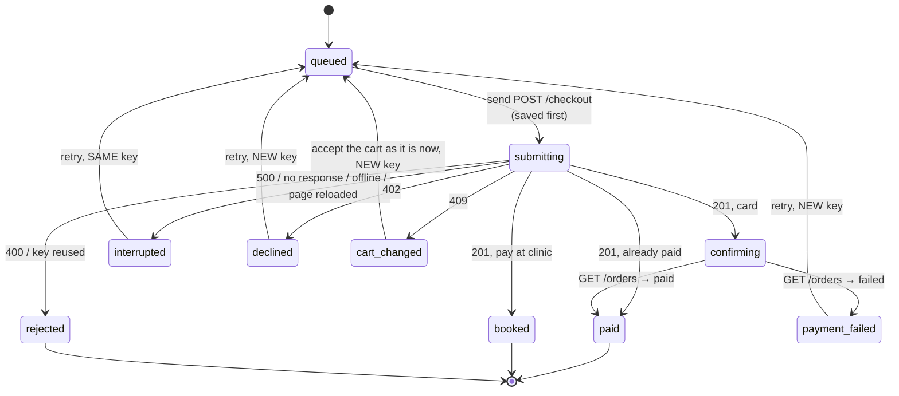
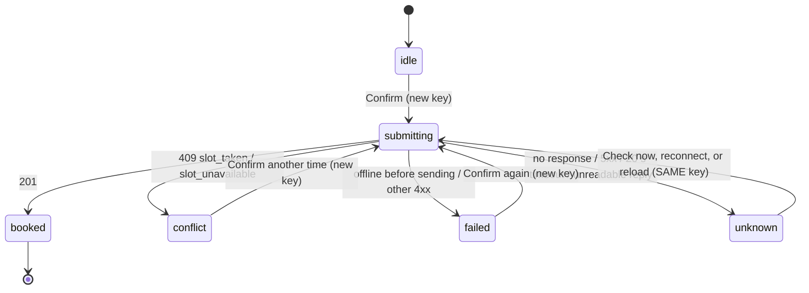

# medex: MedEx take-home exercises

Three exercises from the MedEx senior frontend take-home, built in one app:

- **[Task 1: Service Explorer](#task-1-service-explorer)** (`/`): browse and filter 3,200 services from 67 providers, with live filter counts, prices that never mix currencies, and the whole view in the URL.
- **[Task 2: Multi-provider cart and split checkout](#task-2-multi-provider-cart-and-split-checkout)** (`/cart`, `/checkout`): a cart grouped by service type and paid in several currencies, optimistic quantity changes, split checkout where each group is its own order, partial failures, double-charge prevention, reload safety and a guest cart merged on login.
- **[Task 3: Appointment booking across time zones](#task-3-appointment-booking-across-time-zones)** (`/book`, `/bookings/:id`): a 90-day calendar and slot picker that shows the provider's time and the customer's own side by side, with specialists, group bookings, a slot taken by someone else, and rescheduling.

```
medex/
├── client/   # React 19 + TypeScript + Vite, Tailwind CSS v4, shadcn/ui, TanStack Query, React Router, Vitest
├── server/   # Express 5 + TypeScript mock API, Vitest
└── shared/   # Pure TypeScript used by both: time zones and booking slots (Task 3), Vitest
              # data: server/data/task1-service-explorer.json, task2-cart.json, task3-booking.json
```

## Getting started

Requires Node.js 20 or newer. From the repo root:

```bash
npm install    # installs root tooling, then shared/, server/ and client/ dependencies
npm run dev    # starts the API (http://localhost:3001) and the app (http://localhost:5173)
```

Open http://localhost:5173 for the explorer, http://localhost:5173/cart for the cart, or http://localhost:5173/book to book an appointment. Vite proxies `/api/*` to the Express server.

| Root script     | What it does                                  |
| --------------- | --------------------------------------------- |
| `npm run dev`   | Run server and client together (concurrently) |
| `npm run build` | Build server, then client                     |
| `npm run lint`  | Lint the client                               |
| `npm test`      | Run shared, server, then client unit tests (Vitest) |

The root `package.json` only holds scripts; it is not an npm workspace. See [client/README.md](client/README.md) and [server/README.md](server/README.md) for each app on its own.

### Trying the loading and error states (Task 1)

The mock API is slow or fails on demand. Add these to the app's URL; the client forwards them to every API request:

| URL                                    | Shows                                                              |
| -------------------------------------- | ------------------------------------------------------------------ |
| `/?mockDelay=5000`                     | Skeletons, then "taking longer than usual" after 3 s               |
| `/?mockFail=services`                  | Full error with **Try again** (also `providers` or `all`)          |
| `/?mockFail=categories`                | Partial data: results with a notice, category filter disabled      |
| `/?mockFailRate=0.5`                   | Random failures, retried automatically                             |
| DevTools → Network → Offline           | Offline state before loading; an offline banner after loading      |

# Task 1: Service Explorer

Browse and filter the MedEx service catalogue: 3,200 services from 67 providers, grouped into provider cards. Filter counts update live, prices never mix currencies, and the whole view lives in the URL.

## What the brief asked for, and where it stands

✅ done · ◑ done with a caveat · ✗ not done

| Requirement | Status | Notes |
| --- | --- | --- |
| Services grouped by provider; at most 3 per card plus "View all N services" | ✅ | N reflects the active filters. "View all" expands the card in place ("Show fewer" to fold it); expanded cards are kept in the URL. |
| Filters: type, category → subcategory, provider (searchable), city/country, price range, home test | ✅ | Price range applies per currency, see [Prices and currencies](#prices-and-currencies). |
| Free-text search over title, provider and category | ✅ | Every word must match; case and accents are ignored. |
| Live facet counts; zero-result options hidden or disabled | ✅ | Disabled, see [Facet counts](#facet-counts). |
| Final price = after discount + service charge; round only for display; strike through the original | ✅ | |
| Wellness services priced by duration | ✅ | Shown as "From" the cheapest duration, e.g. "3 durations, 30–120 min". |
| Never mix or convert currencies | ✅ | |
| Visibility: service active, provider active, category active | ✅ | 2,853 of 3,200 services are visible. |
| Sorts: relevance, price low → high, price high → low, rating | ✅ | Relevance is defined in [Sorting](#sorting). |
| URL is the source of truth (filters, sort, page), including reload, sharing and Back/Forward | ✅ | |
| Mobile: filters in a drawer whose "Show N results" counts the pending selection | ✅ | |
| Filter updates within ~100 ms, typing never blocks, no layout shift | ✅ | Measured, see [Performance](#performance). |
| States: skeleton, empty results with a way out, API failure with retry, mock API that fails on demand | ✅ | |
| States: partial data, slow, offline | ✅ | |
| Accessibility: full keyboard use, result count announced | ◑ | Built in and checked in code and headless browsers; not yet walked through with a real screen reader. See [What was left out](#what-was-left-out). |
| README, tests for the key logic | ✅ | 188 tests, see [Tests](#tests). |
| Facet counts stay correct with several filters active | ✅ | Tested against brute force on the real data. |
| Two top-level categories share the slug `ultrasound` | ✅ | Categories are keyed by id and grouped by type. |
| Handle the data's mistakes | ✅ | See [Known data issues](#known-data-issues). |

## Decisions and trade-offs

### How the app is put together

- **The server stays simple.** It returns the JSON as is from three endpoints that mirror the MedEx API (`/api/category/active`, `/api/providers`, `/api/service`), with latency and failure switches. All filtering happens in the browser: with 3,200 services that takes a few milliseconds, and live facet counts need the whole set anyway. With a much larger catalogue, filtering and counting would move to the server.
- **One normalisation layer** (`client/src/domain/catalog.ts`) turns the raw API shapes into clean domain types once:
  - It parses money strictly and applies the visibility rules.
  - It tidies text and records every data problem in an `issues` list instead of throwing.
  - Everything after it works with clean data.
- **Pure functions do the work**, so they are easy to test: pricing, categories, facets, the filter engine, and the URL format. React components only display results and send changes back.
- **TanStack Query** fetches the three resources separately:
  - It retries server and network errors twice, but never retries a malformed response.
  - It pauses while offline.
  - The three query states combine into one page status: loading, offline, error or ready (possibly with missing categories).

### Prices and currencies

- **Formula.** `final = (price − discount) + service charge`. Discounts and charges are each a percentage or a fixed amount. A percentage service charge is taken on the discounted price. All maths stays unrounded; `formatMoney` is the only place that rounds, using `Intl.NumberFormat` per currency.
- **Strike-through.** The original is only struck through when the final price is actually lower; 31 prices have a service charge that cancels the discount.
- **No price.** A missing or unusable price shows **Price on request**. It goes last in price sorts and is excluded by a price range.
- **The currency belongs to the provider** (THB, NPR, INR) and is never converted. The price filter therefore starts with a currency choice:
  - The min/max range only appears once a currency is chosen. A range in one currency means nothing in another.
  - When the current results have only one currency left (for example, after choosing Nepal), it is preselected. It is not written to the URL until a range is set.
  - Changing currency clears the range.
- **Price sort across currencies** groups results by currency, then by price, and shows a notice suggesting a currency is chosen to compare like for like.
- **Wellness services** sort and filter by their cheapest duration (the "From" price).

### Facet counts

- **Each option shows the results you would get by ticking it, given every other active filter.** The engine works this out in one pass over the services: a service that fails only one facet's filter still counts towards that facet. The currency facet also ignores the price range, which is cleared whenever the currency changes.
- **Options with zero results are disabled, not hidden.** The filter layout stays stable as you click, you can see what exists but is ruled out by other choices, and a selected option always stays enabled so it can be cleared.
- **Within one facet, choices combine with OR; across facets, with AND.** Country and city form one location facet: a service matches if its country or its city is selected.
- **Selecting a parent covers its children.** A selected category includes its subcategories, and a selected country includes its cities. The children show as checked and locked, and any of them selected before are dropped. A partly selected parent shows as indeterminate.

### Categories and the duplicate `ultrasound` slug

- Two top-level categories share the slug `ultrasound` (one for packages, one for lab tests), and three subcategories share `thyroid`. Categories are therefore matched and stored by **id**, never by slug.
- The filter tree groups top-level categories under their service type, so the two "Ultrasound" entries read as Packages › Ultrasound and Lab Tests › Ultrasound.
- **Trade-off:** category ids make the URL less readable than slugs would (`?category=<id>`). Readable `type:slug` keys would work too but need a lookup in both directions; ids were chosen for simplicity.

### URL state

Every filter, the search, sort, page and expanded cards live in the query string, so a view can be reloaded, shared or walked through with Back. For example:

```
?q=thyroid&type=lab_test&country=TH&currency=THB&min=500&max=2000&home=1&sort=price-asc&page=2
```

- **The URL stays short.** Defaults are left out, lists are comma-separated, and other parameters (such as the `mock*` flags) are kept.
- **History follows intent:**
  - A filter, sort or page change adds a history entry.
  - Typing a search adds one entry for the first character, then updates it in place.
  - Expanding a card updates the URL in place, so Back doesn't fold cards one by one.
- **A hand-edited or stale URL never breaks the page:**
  - Malformed values fall back to defaults.
  - Unknown types, categories, providers, places and currencies are dropped, and a reversed price range is swapped.
  - An out-of-range page shows the last page.
- **Pagination links are real `<a href>` links,** so a page can be opened in a new tab.

### Sorting

| Sort | Order |
| --- | --- |
| Most relevant, with a search | Matches in a title word first, then elsewhere in the title, then the category, then the provider name. Ties go to the better-reviewed provider. |
| Most relevant, no search | Providers by a review-weighted rating, which pulls ratings with few reviews towards the average (a rating needs about 25 reviews to count at face value). So 5.0 from 2 reviews doesn't outrank 4.7 from 1,200. |
| Price | By final price (the "From" price for wellness). Price on request goes last. Grouped by currency when currencies are mixed. |
| Top rated | Provider rating, then number of reviews. Unrated providers go last. |

Provider cards follow their best service in that order, and services within a card keep it too. Pages hold 10 provider cards.

### States

- **Loading:** skeletons shaped like the real cards and sidebar. After 3 seconds a line says it's taking longer than usual.
- **Error:** a full error with **Try again** when services or providers fail. The message depends on the cause (offline, network, server, or a response we couldn't read).
- **Partial data:** if only categories fail, results still show, with a notice, a retry button and the category filter disabled. Accepted risk: until categories load, the 41 services in the inactive "Seasonal Offers" category can't be hidden.
- **Offline:** before loading, an offline panel that loads automatically when the connection returns. After loading, a banner, and browsing continues.
- **Empty results:** "No services match your search" with a **Clear search and filters** button.

### Mobile

- Below 1024 px the sidebar becomes a **Filters** button that shows how many filters are applied and opens a drawer.
- **The drawer works on a draft.** Counts and the **Show N results** button update as you tick, while the results behind stay put.
- **Show N results** applies everything as one history entry. Closing the drawer any other way discards the draft. With no matches, the button is disabled and **Clear all** sits next to it.

### Accessibility

- **Native controls.** Checkboxes, radio buttons, selects and links are all native elements. Filter groups are `fieldset`/`legend`, and the tree toggles use `aria-expanded` and `aria-controls`.
- **Announcements.** The result count is announced in a polite live region on every change, and the drawer announces its pending count. Price range errors are linked to their fields and announced.
- **Keyboard:**
  - The drawer traps focus, closes with Escape and returns focus to its button.
  - Changing page moves focus to the top of the results.
- **Contrast.** The brand orange was darkened so all text meets WCAG AA. White on the button gradient was 2.3 : 1 and is now at least 4.5 : 1. The values are recorded in `client/src/index.css`.

## Performance

**Target:** filter updates within ~100 ms, typing never blocks, no layout shift.

**How it was measured:**
- The app ran on the dev server, so these are worst-case numbers with React's development build.
- Headless Microsoft Edge was driven through the Chrome DevTools Protocol, at a 1366 × 900 viewport.
- **Filter clicks:** each service type was ticked and unticked three times (15 clicks).
- **Typing:** "blood test" was entered as real key input (10 characters).
- **Latency** is the time from the input to the next painted frame, taken after two `requestAnimationFrame` callbacks.
- **Layout shift** was summed from `layout-shift` entries over the load and all interactions.
- Each run was repeated with the CPU slowed 4×, to stand in for a mid-range phone.

| | Normal CPU | CPU slowed 4× |
| --- | --- | --- |
| Filter click → painted (median / worst) | 18 ms / 34 ms | 61 ms / 80 ms |
| Keystroke → painted (median / worst) | 22 ms / 39 ms | 38 ms / 39 ms |
| Filter engine alone, per update (median / worst) | 2.5 ms / 6.1 ms | 6.8 ms / 19.5 ms |
| Cumulative layout shift (load + interactions) | 0.019 | 0.019 |

Everything stays under 100 ms, and layout shift is well under the 0.1 "good" threshold; the small amount happens during the initial load. Typing never waits on anything slow, so no deferral or debouncing was needed.

**What keeps it fast:**
- The search index (normalised text and provider scores) is built once per load.
- Each change is one pass over the services that filters, scores and counts every facet at once.
- Only one page of 10 cards is rendered.

**To check it yourself:** open DevTools → Performance, record while clicking filters, and look for the `explore` measure in the Timings track. Every filter update is recorded there with `performance.measure`. The CPU can be slowed from the same panel.

## Tests

Task 1 added 188 tests in 24 files (Vitest, Node environment). Most of them run against the real `task1-service-explorer.json`, not just fixtures.

- **Pricing and money:**
  - discount and charge types
  - percentage charge on the discounted price
  - rounding only in display
  - "Free", "Price on request" and the strike-through rule
- **Catalog:**
  - every visibility rule, with the real counts (198 inactive services, 108 from inactive providers, 41 in inactive categories)
  - duplicate ids, untidy titles, unrated providers, and partial data
- **Categories:** the duplicate `ultrasound`/`thyroid` slugs, parent and child matching, and the tree grouped by type.
- **Filter engine:**
  - every facet option's count checked against "select only this option", with a search, two types, a country and home test all active
  - plus search, relevance, every sort, currency grouping, paging and the preselected currency
- **URL state:** parsing, round trips, malformed values, unknown ids, and keeping the `mock*` params.
- **Fetching:** retry rules, page status from the three queries, and error messages.
- **Components:** rendered to static HTML and checked for structure and accessibility attributes (cards, states, filters, pagination, drawer trigger).

Interactions (clicking, typing, Back and Forward, the drawer) were checked in headless Edge at 375, 640, 900 and 1366 px. They aren't automated in the repo; see below.

## What was left out

- **Browser tests in the repo.** Component tests render static HTML. Interaction tests (Playwright, or Testing Library with jsdom) would be the next addition.
- **A screen-reader walkthrough** (VoiceOver/NVDA) and automated axe checks.
- **Back button closing the mobile drawer.** It goes back a page instead. Fixing it means adding a history entry when the drawer opens.
- **Touch target size.** The small show/hide toggles in the category and location trees are 28 px, below the 44 px guideline.
- **Reduced motion.** The drawer's slide animation hasn't been checked against `prefers-reduced-motion`.
- **Dark mode.** The theme has dark tokens, but the page hasn't been designed or checked in dark mode.
- **Cleaning the URL on load.** Unknown or invalid params are ignored at once, but only disappear from the address bar at the next change, to avoid adding a history entry the user didn't ask for.
- **Smarter search.** There's no typo tolerance, stemming or synonyms; relevance is simple word scoring.
- **Number formatting** is English (`en`) only. Since Task 2, amounts always show the currency code ("INR 1,800", not "₹1,800"), in the explorer too.
- **Server-side filtering and pagination**, which a much larger catalogue would need.

## Where AI tools were used

This was built with Claude Code (Anthropic) as a pair programmer, inside VS Code:

- **Analysis and plan:** Claude read the brief and the data and proposed edge cases, open questions and a step-by-step plan. The developer made the product decisions, including:
  - how "View all" behaves
  - partial-data handling
  - category ids in the URL
  - Title Case labels
  - the order of the steps
- **Code and tests:** Claude wrote the code and tests one small step at a time. The developer reviewed each step and made every commit.
- **Data issues:** Claude found them by querying the JSON. The handling of the bigger ones ("Price on request" for a discount larger than the price, documenting issues for the data owner) was agreed with the developer.
- **Measurement:** Claude wrote and ran the performance script and the screenshot checks (in headless Edge).
- **This README:** drafted by Claude.

## Known data issues

Problems found in `server/data/task1-service-explorer.json`. The client never edits the source data. It works around each problem when it normalises the data (`client/src/domain/catalog.ts`) and records it in the catalog's `issues` list.

### Needs fixing at the source

| Issue | Example | What the app does | Suggested next step |
| --- | --- | --- | --- |
| A fixed discount bigger than the price | "Vitamin D Test": price 450, discount 600 (THB) | Shows **Price on request** and leaves the service out of price filters and price sorting. Capping the price at 0 would show "Free", presenting a data error as an offer. Wellness durations with this error are dropped. | Data owner corrects the record. The API or admin tool should reject a discount larger than the price (and percentage discounts over 100%). |
| Untidy title | `"  hba1c   TEST (Diabetes) "` | Trims and collapses spaces; keeps the original casing. | Data owner fixes the title. Trim titles on save. |
| Service that looks miscategorised | "Physiotherapy Appointment" under Vaccination › Travel Vaccines | Shown as is: the category can't be second-guessed automatically. | Data owner reviews the category. |

### Handled by design

| Situation | What the app does |
| --- | --- |
| Two top-level categories share the slug `ultrasound` (package and lab test), and three subcategories share `thyroid` | Categories are matched and stored in the URL by id, never by slug. The filter tree groups top-level categories by service type to tell them apart. |
| 5 providers have a `null` rating and 0 reviews | Shown as "No reviews yet". A rating with no reviews behind it is treated as unrated. |
| 198 inactive services, 108 services from 2 inactive providers, and 41 services in the inactive "Seasonal Offers" category | Hidden (2,853 of 3,200 services are visible). |
| Wellness services have `price: null` and price by duration | Shown as "From" their cheapest duration. |
| "Free Dental Consultation" has a price of 0 with no discount | A legitimate price, shown as "Free". |
| 31 discounted prices where the service charge cancels out the discount (e.g. "Home HbA1c Test": listed NPR 5,690, final NPR 5,724.50) | The original price is only struck through when the final price is actually lower, so no saving is advertised that isn't there. |
| No visible service has "Ultrasound" in its title (the one that does, "Thyroid Ultrasound", is hidden) | Searching "ultrasound" still finds services through their category name. |

---

# Task 2: Multi-provider cart and split checkout

> "I put a lab test from one clinic, a facial from a spa, and a check-up package from a hospital in my cart. Then I tried to pay."

The cart groups services by type. Each group can hold several providers and currencies, and each group is booked and paid as its own order, by card or at the clinic. The hard parts are what happens when things go wrong: a quantity change the server refuses, an order whose response never arrives, a tab closed mid-payment, a guest cart that overlaps the account's.

## Trying it

`npm run dev`, then open http://localhost:5173/cart.

1. **A first visit is a guest's.** The guest cart from the data file is "saved on this device". Press **Log in** to merge it into the account's cart; a notice says exactly what changed.
2. **The cart:** change quantities (try tapping "+" quickly), pick the facial's duration, remove the item the provider withdrew.
3. **Checkout:** "Book all 3 groups", choose card or pay at the clinic for each, then "Place 3 orders".
4. **Make it fail:** open **Mock API** (bottom-left) and pick a scenario, e.g. "Next package checkout: card declined" or "order made, response lost", before placing the orders. Then retry what failed. **Reset demo** in the same panel starts the whole story again.
5. **Reload safety:** reload, or close the tab and reopen `/checkout`, while orders are being placed. Use "Everything slow" in the panel to give yourself time.

The server cart, orders and rules live in memory: restarting the server also resets them.

## What the brief asked for, and where it stands

✅ done · ◑ done with a caveat · ✗ not done

| Requirement | Status | Notes |
| --- | --- | --- |
| Mock API: the 7 endpoints, realistic latency, data mapped rather than imported | ✅ | Express, 300 ms default latency. Plus `GET /api/catalog` (to show a guest's cart) and dev-only `/__mock/*` controls. See [server/README.md](server/README.md). |
| Make a specific call fail or slow down on demand | ✅ | The Mock API panel, see [Trying the failure cases](#trying-the-failure-cases). Task 1's query flags still work. |
| `POST /checkout` honours the idempotency key | ✅ | Same key and request → the same order (with its current status); same key, different request → 409. |
| Cart grouped by type, a subtotal per currency, no grand total across currencies | ✅ | |
| A summary that still helps the customer understand what they'll pay | ✅ | One total per currency, how many separate bookings, what isn't priced yet. |
| Optimistic quantity changes, rolled back with a reason; five quick taps end right, with no flicker or racing requests | ✅ | Verified in a real browser: five taps sent two ordered requests (2, then 6). See [Changing quantities](#changing-quantities). |
| Wellness needs a duration before its group can be checked out; never counted as zero | ✅ | |
| Unavailable items clearly marked, can't be checked out, easy to remove | ✅ | |
| Split checkout: one group or everything; each group a separate order with its own payment method | ✅ | |
| Partial failure: nothing lost or charged twice; clear about what succeeded; retry only what failed; no duplicate orders | ✅ | Verified with an order created on the server whose response was replaced by a 500: the retry returned the same order. |
| Reload safety: the true state of each order after a refresh or a closed tab | ✅ | Verified by closing a real tab mid-request. See [Reload safety](#reload-safety). |
| Guest cart merged on login, each overlap handled and explained | ✅ | See [Guest cart merge](#guest-cart-merge). |
| States: loading, empty, slow, offline, error | ✅ | Plus a failed refresh that keeps the cart on screen. |
| Every action keyboard-accessible; focus managed on removal and checkout steps | ◑ | Built in and checked in a headless browser with scripted focus; no full keyboard-only or screen-reader walkthrough. See [What was left out](#what-was-left-out-task-2). |
| Contrast | ◑ | New colours (amber and emerald status text) haven't been measured. |
| Performance with realistic data volume | ◑ | Totals are recomputed only when the cart changes, but large carts haven't been measured. |
| State machine in the README; how double charges are prevented; explaining several orders | ✅ | See [Checkout](#checkout-the-state-of-each-order). |
| README, tests for the most important logic | ✅ | 384 tests in total; see [Tests](#tests-task-2). |

## How it's put together

**Stack additions, and why:**

- **React Router** for the three pages. Task 1's explorer keeps its own query-string state; the router only owns the path.
- **No separate state library.** Server data stays in TanStack Query, as in Task 1. The three pieces of client state that outlive a component are small classes with `subscribe`/`getSnapshot`, read through `useSyncExternalStore`. They have no React in them, so they can be tested with fake API calls and hand-resolved promises. A library like Zustand would have worked too; it wasn't needed.

**Where each piece of state lives:**

| State | Where | Why there |
| --- | --- | --- |
| The account's cart, exactly as the server sent it | TanStack Query cache (`cartKey`) | Server data. Components derive the clean model with `normaliseCart`, so optimistic edits work on the server's own shape. |
| Quantities being saved, and why a change failed | `QuantitySync` (`client/src/state/quantitySync.ts`), one per QueryClient | Needs to queue requests per line and survive re-renders; layered over the cache rather than written into it. |
| The order cart responses are applied in | `CartWrites` (`client/src/state/cartWrites.ts`) | Shared by every cart write, so an older response never overwrites a newer one. |
| The checkout session: orders, keys, phases | `CheckoutStore` (`client/src/state/checkoutStore.ts`) + `localStorage` | Must outlive the page component (leaving mid-checkout neither stops nor duplicates it) and the page itself (reload safety). |
| Guest or customer, and the device's guest cart | `AccountStore` (`client/src/state/accountStore.ts`) + `localStorage` | Device state that the header, cart and checkout all read. |
| Payment methods while reviewing, focus targets, announcements | Component state | Only that page needs them. The groups being booked are in the URL, so a reload keeps them. |

The rules (prices, group readiness, the checkout state machine, key rules, error classification) are pure functions in `client/src/domain/cart` and `client/src/domain/checkout`, separate from the stores that run them.

## How the client reads the cart

The client never takes the cart's numbers on trust (`client/src/domain/cart/`). It keeps the server's groups, because each group is checked out as one order, but recomputes every count, line total and subtotal from the lines. Anything odd is recorded in the cart's `issues` list, as in Task 1.

- **A price is either known or blocking, never zero.** Each line is *priced*, *blocked* (price unknown) or *unavailable* (service removed). A blocked line stops its group from being checked out and is counted in the summary as "not priced yet"; it is never added to a total. Lines are blocked for: a wellness service with no duration chosen; a wellness service with no usable durations; a missing, negative or malformed price or currency; or a quantity that isn't a whole number of at least 1.
- **Wellness prices come only from the chosen duration.** A fixed `price` on a wellness service is ignored (and flagged), and the `priceUnknown` flag isn't relied on. Duration options without an id, a positive duration or a valid price are dropped. A selected duration the service no longer offers counts as not chosen.
- **Removed services are left out of orders, not blocking.** A removed service in a group that can otherwise be booked doesn't hold the group back: it is shown as unavailable and left out of that group's order. A group with only removed services (the `unknown` group in the data) isn't an order at all and is listed last.
- **Amounts always show the currency code** ("INR 23,009.50", not "₹23,009.50"). With up to three currencies side by side, a mix of symbols and codes is harder to compare. This also changed the explorer from Task 1, which used to show ₹.
- **The summary never adds currencies.** It shows one total per currency across all groups, how many separate orders the cart becomes, and how many items aren't priced yet.
- **Smaller tidying:** lower-case currency codes are accepted (`thb` → THB), titles are trimmed, a line with no id is skipped (nothing can be done with it), and server subtotals that disagree with the lines are flagged.
## Changing quantities

Quantity changes are optimistic (`client/src/state/quantitySync.ts`). The new number shows the moment "+" or "−" is tapped, and the line's price and the group and cart totals update with it.

- **One request per line at a time, newest value wins.** While a change is being saved, further taps only move the target; when the request returns, the latest target is sent. Five quick taps from 1 send two requests (2, then 6), in order, and the screen goes 2, 3, 4, 5, 6 without jumping back. Tapping back to the saved value sends nothing more. Lines don't wait for each other.
- **Out-of-order responses can't undo anything.** Every write returns the whole cart, and responses can arrive in any order. A response to an earlier request never replaces one to a later request (`client/src/state/cartWrites.ts`), and quantities the customer touched stay on top of the cached cart until a reload, made once everything has settled, confirms them.
- **When the server refuses, the line goes back and says why.** A 409 or 500 restores the last quantity the server accepted, and the line shows (and announces) the reason, e.g. "You can book up to 10 of one service at a time. It's back to 10."
- **When the outcome is unknown, the cart is reloaded instead.** If the connection drops mid-request, the change may or may not have been saved, so rolling back could be just as wrong as keeping it. The cart is reloaded and the line says so.
- **Offline:** steppers are inactive, and the banner explains that changes wait until the connection is back.
- **No client-side maximum.** The server owns the booking limit; the client shows its 409 rather than duplicating the rule.
- **Keyboard:** "−" at 1 is marked `aria-disabled` rather than `disabled`, so focus isn't thrown back to the top of the page. Going below 1 means removing the item, which gets its own button.
## Choosing a duration and removing items

- **Wellness durations are a radio group** ("60 min · THB 1,800"), labelled with the service's name for screen readers, so arrow keys move between them. The choice shows at once; the price, group status and summary update when the server confirms it. Until then the price says "Price shown once you choose a duration" and is never counted as zero. If the duration is no longer offered (409), the line says so and the cart is reloaded.
- **Every line has a Remove button**, outlined for services the provider removed, since removing is the only thing left to do with them. A removal isn't optimistic: the line stays, showing "Removing…", until the server confirms, so a failure doesn't make a removed line reappear. There's no confirmation dialog or undo: the item can simply be added again.
- **Focus after a removal** goes to the next line in the group, else the previous one, else the next (or previous) group's heading, else the page heading once the cart is empty. The removal is also announced ("CBC Profile was removed from your cart.").
- **No stale reloads.** Both actions cancel any cart reload in flight first, and take part in the same response ordering as quantity changes, so an older response can't bring back a removed line or an old duration.
## Checkout: the state of each order

Each group in a checkout becomes its own order, paid on its own, so each has its own state (`client/src/domain/checkout/machine.ts`). "Pay for everything" submits the groups one after another, in the cart's order, and carries on past a failure, so one problem never holds up the rest.



### What the customer sees

- **From the cart:** each ready group has its own "Book" button, and the summary offers "Book all 3 groups" (or "Book the 2 ready groups" while one still needs a duration). The choice goes in the URL (`/checkout?groups=package,lab_test`), so a reload keeps it.
- **Review:** each group is shown as "Order 1: Packages", with its items, providers, totals per currency and its own payment method (card, or pay at the clinic; insurance is card only). The page says plainly that these are separate orders and that one problem won't affect the others. Nothing is sent until "Place 3 orders".
- **Results:** one card per order, in plain terms of money and booking: "Paid and booked", "Booked. Pay at the clinic", "Your card was declined. No order was placed and you haven't been charged", "We couldn't confirm this order. Trying again is safe: you will never be charged twice for it." Orders that exist show a short reference. A sentence at the top ("2 of 3 orders done, 1 needs your attention") is announced to screen readers as it changes.
- **Retry only what failed:** "Try again" appears only on orders that can be retried, plus "Try all 2 again" when there are several. After a decline or a failed payment the customer can switch to paying at the clinic first. If the cart changed, they can place the order again with the cart as it is now.
- **Leaving:** while an order is in progress or its outcome is unknown, the page offers "Back to cart" and keeps the checkout; the cart shows a banner linking back to it, and won't start another checkout until it's resolved. Once everything is settled, "Done" (or "Leave the rest in my cart") clears it. Checkout runs outside the page component, so leaving mid-checkout neither stops it nor starts a second copy on return.
- **Focus:** placing the orders moves focus to the results heading; retrying an order moves it to that order's heading, since the button that was pressed disappears.
- **No real card entry.** "Card" is a choice, not a form: a real integration would use the payment provider's hosted fields, which is out of scope for a mock.

### How double charges are prevented

- **Every attempt carries an idempotency key, and the key outlives uncertainty.** If we don't know whether an order was created (a 500, a dropped connection, the tab closed mid-request), the retry reuses the same key. The server either creates the order or returns the one it already made; it never makes a second one.
- **A key is spent only when we know no usable order came of it:** a declined card (402), a payment that failed after the order was made, a cart that changed (409), or a request the server refused (400). The next attempt is then a genuinely new order, with a new key.
- **The payment method is locked while a key is outstanding.** The first attempt may already have created an order by card; switching to "pay at clinic" with the same key would be a different request, which the server rightly refuses. Once the attempt is known to have failed, the method can change.
- **Retry only what failed.** Succeeded orders are never resubmitted; the retry action exists only for interrupted, declined and failed orders.
- **Late or duplicate events are ignored.** The reducer only accepts events that fit an order's current phase, so a double click or a response arriving after a reload can't move an order backwards.
- **One request at a time.** Orders are submitted one after another, which also keeps progress easy to follow.

### Reload safety

The checkout session (orders, items, payment methods, keys and phases) is saved to `localStorage` on every change, and **before** each request is sent (`client/src/domain/checkout/storage.ts`). If the page reloads or the tab is closed mid-checkout:

- an order that had a request out comes back as *interrupted*, and is **resent automatically with the same key** as soon as the page loads. The server returns the order if the first request made it, or makes it now; either way the page shows the truth without the customer doing anything ("Checking on this order… If it already went through, you won't be charged twice.");
- orders the customer had already asked to place but that hadn't been sent yet carry on in turn: they pressed "Place 3 orders", so restarting the checkout would be the surprise;
- an order waiting for its card payment carries on being checked with `GET /orders/:id`;
- finished orders show as finished; nothing starts again from scratch.

If the page loads offline, nothing is resent until the connection is back; orders that failed *because* the customer was offline are also resent on reconnect. Server errors (500) are left for the customer to retry, so a failing server isn't hammered.

**Tested by closing a real tab mid-request** (headless Edge, the package request held for 3 s by a mock rule): the saved session had `package: submitting` with its key and no response; the new tab resent that same key without a click, got back the order the first request had made (a second order would have been refused, since the package's items had already left the cart), then placed the two remaining orders.

**Two tabs** aren't synchronised: each tab runs the checkout it loaded. Because every resend uses the saved key, two tabs resolving the same order still produce one order. A real server must also handle two requests with the same key arriving at once (by locking on the key); the mock processes requests one at a time, so it doesn't need to.

A session that can't be read (corrupt, or an unknown version) is dropped rather than guessed at. If storage isn't available at all (some private modes), checkout still works but can't survive a reload.
## Guest cart merge

When a guest logs in, the cart saved on their device is merged into their account's cart (`POST /api/cart/merge`, logic in `server/src/cart/merge.ts`). Every item is merged on its own, so one bad item never blocks the rest, and the server reports each outcome in `changes` so the customer can be told exactly what happened.

### What the customer sees

There are no real accounts in this exercise, so logging in is pretend (`client/src/state/accountStore.ts`), but the moment a guest becomes a customer is real:

- **A first visit is a guest's.** The guest cart from the data file stands in for what they saved earlier, and is stored on the device (`localStorage`). The cart page lists it ("Saved on this device"), resolving product names through `GET /api/catalog` because a guest cart holds only product ids. Booking asks the guest to log in.
- **Logging in merges, then logs in.** If the merge fails, nothing changes: the guest stays a guest with their items, and is told it's safe to try again. It is, because the merge keeps the larger quantity and so can be repeated.
- **Then the cart opens with a "What changed" notice**, one sentence per case, and focus moves to it so a screen reader announces it first. The device's cart is emptied, since its items now live in the account.

### The cases in the data

The guest cart in `server/data/task2-cart.json` overlaps the account's cart in four ways:

| Guest item | Account's cart | What happens | What the customer is told |
| --- | --- | --- | --- |
| Liver Function Profile ×3 | Same test ×2 | The line keeps the **larger** quantity: 3. | "Liver Function Profile: kept 3 from before you logged in (your account had 2)." |
| Lipid Profile ×1 | Not there | Added as a new line. It joins the lab tests group (THB, Lotus Pathology). | "Lipid Profile added." |
| Signature Facial, 90 min | Same facial, **no duration chosen** | The guest's 90 min choice is applied to the existing line. No second facial is added. The wellness group now has a price (THB 2,040) and can be checked out. | "Signature Facial: we used the 90 min you chose earlier." |
| Product `6b572fa4-…` | Not there, and not in the catalog | Not added. | "1 item you added before logging in is no longer offered." |

### The rules behind them

- **Quantities are never added together; the larger one wins.** A customer who had 2 of a test in their account and later put 3 in a guest cart almost certainly wants 3, not 5. Adding them would book (and charge for) tests nobody asked for, and in healthcare an extra lab test is not a harmless extra. The cost: a customer who really wanted 5 has to tap "+" twice, and the message tells them what was kept. A useful side effect is that the merge is **safe to repeat**: if the response is lost and the client sends the guest cart again, nothing changes the second time.
- **A wellness duration chosen as a guest fills in a missing one.** If the account's line has no duration yet, the guest's choice is used, because that's the most recent decision the customer made.
- **Two different durations stay as two lines.** A 60 min and a 90 min facial are different bookings, so neither overwrites the other. A guest item with no duration folds into the account's existing line for that service.
- **Products that aren't in the catalog are skipped and reported.** The data gives no title for them, so the message can only say how many items were skipped.

### Edge cases the data doesn't contain, handled anyway

| Situation | What happens |
| --- | --- |
| Merged quantity over the booking limit (10) | Capped at 10, and the customer is told. |
| The guest's chosen duration is no longer offered | The service is added without a duration, and the customer is asked to choose one. |
| Unreadable item (no product id, quantity 0, negative or not a whole number) | Skipped and reported; the other items still merge. |
| The same product twice in the guest cart | Merged with the same "larger wins" rule. |
## Trying the failure cases

Every page has a **Mock API** button in the bottom-left corner. It opens a panel (not a modal; Escape closes it) that talks to the mock server's runtime rules (`PUT /api/__mock/config`, see `server/README.md`):

- **Scenarios**, one click each: the next package checkout is declined (402); the next lab test order is made but its response is lost (500 after the work); the connection drops after an order is made; the next quantity change is refused (409) or fails (500); the next login's merge fails; loading the cart fails; everything is slow (+3 s); card payments fail after the order is placed.
- **Custom rule:** any call, any error status or a dropped connection, before or after the work is done, for one group or all, once or every time, with extra delay.
- **Active rules** in plain words, each removable; "next time only" rules drop off once used.
- **Reset demo** restores the original cart, forgets every order and the checkout, and makes you a first-time guest with saved items again, so the whole story can be replayed.

The panel ships in every build, collapsed, because reviewers need it on a deployed copy too; in a real product it would be behind a development flag. The Task 1 query flags (`?mockDelay=3000`, `?mockFail=cart`) still work. For offline, use the browser's network tools.
## Known data issues (Task 2)

| Situation | What happens |
| --- | --- |
| A cart line whose `product` is `{}` (the provider removed the service) | The server puts it in an `unknown` group with no price. It can't be checked out or have its quantity changed (409 `unavailable`); it can only be removed. |
| The server cart's `subtotals`, `itemCount` and `totalItems` are precomputed | They match the lines in the data file, but the server recomputes them from the lines on every response rather than trusting stored totals. |
| Fractional prices (INR 23,009.50, THB 5,227.50) | Totals are summed in whole cents so they never drift (e.g. 0.1 + 0.2). |

## Tests (Task 2)

`npm test` runs **384 tests**: 34 on the server and 350 in the client (of which Task 2 added 162). They run in Node with Vitest, mostly against the real `task2-cart.json`.

- **Server:** cart totals per currency in cents; the quantity limit and removed products; checkout idempotency (same key returns the same order, even after it settled; a reused key for a different request is refused); every kind of mismatch when the cart changed; failed payments returning lines to the cart; every merge case in the data plus repeat-safety and edge cases; mock rule matching and "after the work" failures.
- **Cart domain:** normalising every kind of bad line (missing price, bad currency, broken durations, invalid quantity, removed product, type mismatch); subtotals and the summary never adding currencies or counting unknown prices as zero; the items sent for checkout.
- **Quantity sync:** five quick taps sending two ordered requests; rollback on refusal; independent lines; unknown outcomes; the server choosing a different quantity; removal mid-sync.
- **Checkout state machine:** every transition; the key kept or spent in each case; the payment-method lock; late and duplicate events ignored; error classification.
- **Checkout store:** orders placed one at a time past a failure; retry with the same key; a new key after a decline; saving before sending; polling card payments; resuming after a reload; waiting for a connection.
- **Storage and account:** corrupt or unreadable sessions, unavailable storage, the guest cart seeded, merged, failed and retried.
- **Components:** rendered to static HTML and checked for content and accessibility attributes (the cart in every state, steppers, duration radios, remove buttons, the partial-failure results screen).

### Checked in a real browser

The interactions were driven in headless Edge through the DevTools protocol, against the real server, during development. These scripts aren't in the repo.

- Five quick taps on "+": the screen went 2, 3, 4, 5, 6 without jumping back, two requests were sent (2, then 6), and the server ended at 6.
- A failed quantity change rolled back and announced the reason.
- Choosing a duration, removing items, where focus lands afterwards, and the announcement.
- **The partial-failure case:** the package order was created on the server but its response replaced by a 500. The other orders went through, and the retry sent the same key and got the same order back.
- **Reload safety:** the tab was closed while the package request was out. The new tab resent the same key without a click, got the order the first request had made, then placed the remaining orders.
- The guest flow from a fresh profile, including the merge notice's wording and the totals afterwards.
- The dev panel: a scenario taking effect, Escape returning focus, and Reset demo.
- Layouts at 390 px and desktop width.

## What was left out (Task 2)

**The accessibility and performance pass was planned but not done.** In particular:

- **No keyboard-only or screen-reader walkthrough.** Focus moves and announcements were checked with scripts, not by tabbing through or listening with VoiceOver or NVDA. No automated axe checks.
- **Contrast of the new colours isn't measured:** the amber "needs attention" and emerald "ready" text, and the destructive red on tinted backgrounds.
- **Large carts weren't measured.** The cart is re-normalised on every quantity tap. That's cheap for this data, but a cart with hundreds of lines hasn't been profiled.

**Other things left out, and what I'd do next:**

- **Interaction tests in the repo.** The browser checks above were scripts run during development. Next step: Playwright tests for the five-taps, partial-failure and reload cases.
- **The server doesn't check prices at checkout.** It refuses an order if quantities or durations changed, but not if a price changed between review and payment. The request should carry the totals the customer saw, and the server should refuse if they differ.
- **Concurrent requests with the same key.** The mock processes requests one at a time, so two requests with the same key can't race. A real server must lock on the key.
- **Two tabs aren't synchronised.** Each tab runs the checkout it loaded. Idempotency keys still prevent duplicate orders, but one tab won't see the other's progress until it reloads. Listening to the `storage` event would fix that.
- **Polling never gives up.** A card payment that never settles shows "Confirming your payment…" indefinitely, checked every 1.5 s. A real app would back off and eventually say "we'll email you".
- **Pay at the clinic stays `pending` forever**, as the API's statuses allow nothing else. The client treats it as booked.
- **No real card entry.** "Card" is a choice; a real integration would use the payment provider's hosted fields.
- **No undo for removing an item.** It can be added again, so there's no confirmation either.
- **One extra cart request after each burst of quantity changes**, to let the server's values replace the local ones. Correct, but chatty.
- **After a reload, orders already queued are placed without asking again.** The customer pressed "Place 3 orders". Asking again would be a small change if MedEx prefers it.
- **The dev panel ships in every build**, collapsed, so reviewers can use it on a deployed copy. In a real product it would be behind a development flag.
- **Login is pretend**, and logging out doesn't clear a checkout session; it is only shown to the customer.
- **An observation I couldn't reproduce:** during one manual browser run, the server ended with an untouched line's quantity at 2. Four reruns with every request logged sent exactly the expected writes and left it at 1. I believe it came from the test session rather than the app, but I couldn't prove it.

## Where AI tools were used (Task 2)

Built with Claude Code (Anthropic) as a pair programmer in VS Code, in the same way as Task 1:

- **Analysis and plan:** Claude read the brief and the data, listed edge cases and open questions, and proposed a 14-step plan. The developer made the product decisions, including:
  - a server-backed dev panel rather than query flags alone;
  - merge rules: the larger quantity wins, a guest's duration fills a missing one, unknown products are skipped and reported;
  - "Pay for everything" placing orders one after another and carrying on past a failure;
  - stopping before the accessibility and performance pass.
- **Code and tests:** Claude wrote them one step at a time. The developer reviewed each step and made every commit.
- **Browser checks:** Claude wrote and ran the headless Edge scripts described above, and reported what it saw, including the one result it couldn't explain.
- **This README:** drafted by Claude.

---

# Task 3: Appointment booking across time zones

> "I live in Kathmandu. I'm booking a check-up at a hospital in Bangkok for when I travel there next month. Which time is the appointment, mine or theirs?"

The booking picker a customer uses to choose a specialist, a date and a time, book for up to 4 people, and move an existing booking. Every time on screen is the provider's, because that's where the customer has to be, with the customer's own time beside it. The hard parts are the data (six providers, six ways of writing a time zone), what "today" means at the provider, slots with buffers, and a booking whose result is unknown.

## Trying it

`npm run dev`, then open http://localhost:5173/book.

1. **Choose Riverside International Hospital** (Bangkok). If your computer isn't set to Kathmandu, open **Mock API** (bottom-left) and set **Your time zone** to `Asia/Kathmandu`: that's the brief's story. Every time now shows Bangkok time first and yours under it.
2. **Choose Dr. N. Rana.** Fridays and Saturdays say *Off*: choose one to read why. On a Monday, the times end at 7:40 PM, and a note explains the hospital closes at 8:00 PM.
3. **Choose 3 people** and a day: only start times with 3 free slots in a row are offered; the rest say "No room for 3".
4. **Book a time.** Before confirming, the review shows the appointment on both clocks.
5. **Make it go wrong:** in **Mock API**, pick "Next booking: someone else takes the slot first" or "made, then the connection drops", then confirm again.
6. **Reschedule the existing booking:** on `/book`, enter `BK-20261008-0042` under *Manage a booking*, then **Change date or time**.
7. **Late evening:** set your time zone to `Asia/Bangkok` and open Aravali Hospital (India): Dr. V. Mehra's 11:00 PM is 12:30 AM the next day for you.

Bookings live in memory on the server: restarting it (or **Reset demo** in the panel) puts the data file back.

## What the brief asked for, and where it stands

✅ done · ◑ done with a caveat · ✗ not done

| Requirement | Status | Notes |
| --- | --- | --- |
| Mock API: the 4 endpoints, `dayOffset` turned into dates at startup, realistic latency | ✅ | Under `/api/booking` (Task 1 already owns `/api/providers`). Plus a list of providers and a 90-day availability summary; see [How it's put together](#how-its-put-together-task-3). |
| 409 on demand, latency and failures on demand | ✅ | Mock API panel scenarios, including a `raced` rule where someone else really does take the slot first. See [Trying the failure cases](#trying-the-failure-cases-task-3). |
| Every `timezone` value handled; a fallback to the country | ✅ | See [Time zones](#time-zones). |
| Calendar for 90 days; past, closed and full days visibly unavailable, with the reason | ✅ | A word in each cell, the full sentence on selection and in its accessible name. |
| Two clocks, never confusing | ✅ | See [The two clocks](#the-two-clocks). |
| Slots grouped; booked slots visible but not selectable | ✅ | Morning, afternoon, evening, by the provider's clock. |
| Today's started slots unavailable, by the provider's clock | ✅ | Re-checked every 15 s while the page is open. |
| Specialists narrow the slots; hours outside opening hours explained | ✅ | |
| Group bookings: N consecutive free slots | ✅ | Buffers included; see [Slots and groups](#slots-and-groups). |
| 409: keep everything, explain, offer the closest alternatives | ✅ | |
| Reschedule with an unmistakable old → new | ✅ | |
| Skeletons, not spinners, for the calendar and slots | ✅ | |
| A day with no slots, or no availability in 90 days: explain and offer a way forward | ✅ | The data never has the second case; the Mock API panel can make one. |
| API failure: retry without losing selections | ✅ | Selections live in the URL. |
| Slow and offline: never confirm a booking whose result is unknown | ✅ | See [Booking, and results we don't know](#booking-and-results-we-dont-know). |
| Keyboard and screen readers for the calendar and slots | ◑ | Built in (date-picker grid, radio buttons, labels), checked with scripted key presses only. The accessibility pass was dropped; see [What was left out](#what-was-left-out-task-3). |
| Unit tests for the time-zone and slot logic, including the awkward cases | ✅ | 335 tests added; see [Tests](#tests-task-3). |

## How it's put together (Task 3)

**One copy of the time logic, shared by server and client.** The server needs it to date the data and to check bookings; the client needs it for "now at the provider", the two clocks and the consecutive-slot rules. Both import `shared/`, a dependency-free TypeScript package with its own tests:

- `shared/time/`: reading a provider's `timezone`; converting the provider's wall-clock times to real moments and back; dates without a zone.
- `shared/booking/`: reading opening and consultation hours defensively; the slot rule; runs of free slots for groups; each day's status and reason; nearest alternatives.

Because the server now compiles `../shared`, its build output moved to `dist/server/src/` (`npm start` points there).

**No date library.** Everything is built on `Intl`, which both Node and browsers have. A library such as the Temporal polyfill would have worked, but the job here is narrow (offsets, wall-clock ↔ moment) and the tricky parts are in the data, not the arithmetic. The code is small enough to test exhaustively and to explain line by line.

**Two endpoints beyond the brief:**
- `GET /providers` lists providers, so there's somewhere to start, and so the five other time-zone formats can be seen.
- `GET /providers/:id/availability?specialistId&numberOfPeople` returns each of the 90 days with its status and reason. Without it the calendar would need 90 slot requests.

`POST /bookings` also takes an optional `idempotencyKey`, and conflicts carry `details.alternatives`. Full API: [server/README.md](server/README.md#booking-endpoints-task-3).

**Where each piece of state lives:**

| State | Where | Why there |
| --- | --- | --- |
| Providers, availability, a day's slots, a booking | TanStack Query cache, normalised | Server data. Availability and slots share a key prefix per provider, so any booking change refreshes both. The availability key includes the provider's date, so the calendar reloads itself at midnight there. |
| Specialist, number of people, date, time | The URL (`?specialist=&people=&date=&time=`) | A retry, reload or shared link keeps the customer's choices. Choices replace the history entry, so Back leaves the page. |
| A booking attempt: its key and whether its result is known | A reducer (`client/src/domain/booking/submission.ts`) + `localStorage` | Must survive a reload: an attempt that may have reached the server is resent, never forgotten. |
| The customer's time zone | The device's, or the dev panel's override in `localStorage` | Read through `useSyncExternalStore`, so every page updates when it changes. |
| The calendar's focused day and month | Component state | Only the calendar needs it. |

The rules are pure functions (`shared/`, `client/src/domain/booking/`); components only display them.

## Time zones

`resolveProviderTimeZone` (`shared/time/resolveTimeZone.ts`) reads a provider's `timezone` in this order:

1. **An IANA name**, trimmed and with its case fixed. Old spellings are mapped to current ones (`Asia/Katmandu` → `Asia/Kathmandu`, `Asia/Calcutta` → `Asia/Kolkata`).
2. **A Windows zone name**, from a small table for MedEx's region (`Nepal Standard Time`, `India Standard Time`, `SE Asia Standard Time`, …).
3. **A UTC offset** in any of the formats seen (`UTC+05:45`, `(GMT+5:45)`, `+0545`, `(UTC+05:45) Kathmandu`). An offset that matches the country's zone becomes that zone, so customers see "Kathmandu", not "UTC+5:45". One that doesn't match is kept as stated.
4. **The provider's country** (TH, NP, IN: each has one zone and no daylight saving).
5. **Nothing**: the provider is shown, but "Online booking isn't available here". A guessed zone would put customers at the clinic at the wrong hour.

Every value in the data is in the [table below](#known-data-issues-task-3).

**Three things `Intl` does that the code works around:**
- It reports old names (`Asia/Katmandu`, `Asia/Calcutta`) even when given current ones, so names shown to customers come from our own table.
- It quietly accepts abbreviations: `"IST"` becomes Kolkata (IST is also Israel and Ireland), `"EST"` becomes Panama. Names without a `/` other than UTC and GMT are therefore not trusted.
- It accepts offset ids such as `"+05:45"` only in newer engines, so fixed offsets are computed by hand.

**Wall-clock times to moments** (`shared/time/zone.ts`): none of the providers' zones have daylight saving, but the conversion handles it anyway (tested with New York). A time that happens twice when clocks go back is read as the first one; a time skipped when they go forward is read as just after the gap.

**The customer's zone** comes from the device, through the same name handling (a Kathmandu device reports `Asia/Katmandu`). If it can't be named, the device's current offset is used.

## The two clocks

The brief's question was "which time is the appointment, mine or theirs?" The answer is on screen before any time is:

- **A box at the top:** "Times are shown in Bangkok time. That's where your appointment is. Your own time (Kathmandu) is shown under each time, in grey. Bangkok is 1 hour 15 minutes ahead of you." Below it, both clocks, live, each with its date when the two dates differ.
- **One visual rule everywhere after that:** the provider's time is bold; the customer's is smaller, grey and always followed by "your time". Screen readers hear "10:40 AM Bangkok time, 9:25 AM your time".
- **The customer's date appears whenever it isn't the provider's:** Dr. Mehra's 11:00 PM in India reads "12:30 AM, Tue, Nov 3 your time" for a customer in Bangkok.
- **The review and confirmation** label each line: "When, in Bangkok" and "Your time (Kathmandu)".
- **One clock when one is enough:** a Kathmandu customer booking a Kathmandu clinic sees "All times are in Kathmandu time, the same as your own clock."
- **Times follow the customer's own style** (6:40 PM or 18:40), from their browser's locale. The data's `HH:MM` is never shown raw.

## Dates, and "today" at the provider

- **`dayOffset` counts from today at each provider**, so the server turns it into a date on that provider's own calendar when it starts. At 00:30 in Bangkok, Riverside's day 0 is the 28th while Himal Neo's (Kathmandu) is still the 27th. Tested.
- **The calendar is the provider's calendar.** When the customer's date differs, the page says so: "Dates follow the calendar in Bangkok. It's already Wednesday, 28 October there."
- **"Already started" is measured on the provider's clock:** a slot's start is converted to a real moment and compared with now, whatever the customer's device thinks the date is.
- **Midnight while the page is open:** the browser works out "today at the provider" itself, so yesterday turns grey at midnight there without waiting for the server, and the calendar reloads.
- **The 90 days are today plus the next 89**, at the provider.
- **The server dates the data once, at startup.** If it runs past midnight at a provider, the data's days don't move. A real API has real dates; this only affects the mock.

## Slots and groups

`shared/booking/slots.ts`:

- **The slot rule, as the brief states it:** slots start at the start of consultation hours and repeat every duration + buffer. The last slot is the last one that ends (by duration) by the end of those hours.
- **The buffer after the last slot doesn't need to fit.** Dr. V. Mehra's 11:00 PM slot ends at 11:25 PM; its buffer would run to 11:30 PM, the end of his hours. It's offered.
- **A slot is offered only if it fits entirely inside the opening hours.** A last slot that ends exactly at closing time is offered (Dr. M. Thapa's 10:00–10:30 PM at a clinic that closes at 10:30 PM).
- **When opening hours cut a specialist's hours, the customer is told why:** "Dr. N. Rana's hours run to 9:00 PM, but Riverside International Hospital closes at 8:00 PM on Mondays, so the last time is 7:40 PM." When they cut all of them, the day is *Off*: "…closes at 5:00 PM on Fridays, before Dr. N. Rana's hours start at 6:00 PM."
- **A booking holds the doctor for duration + buffer from its start**, and so does each slot. Comparing them that way, a booked time that isn't on the slot grid (10:30 on a 10:00, 10:40 grid) blocks every slot it overlaps instead of matching none. The data has no such times; the rule is tested anyway.
- **Groups need N slots in a row:** each must start exactly one step (duration + buffer) after the one before, and all must be free and not started. With Dr. Wongsakul (30 + 10 min), 3 people from 10:00 take 10:00, 10:40 and 11:20 and end at 11:50. A gap in the list breaks a run. Only start times with room for the group are offered; other free slots say "No room for 3".
- **A day's status** is one of available, past, outside the window, closed that weekday, a one-off closure (with the provider's reason), specialist off, fully booked, no time left today, or not enough slots in a row. Checked in that order, so a holiday reads as a holiday, not as "fully booked".

## The calendar and the day's times

- **Calendar:** one month at a time, Sunday first (the usual week in Thailand, Nepal and India). Each unavailable day has a word in its cell (Closed, Off, Full, Ended, Too few), explained in a legend. Every day in the window can be chosen, even an unavailable one: the panel beside it then says why and offers the nearest bookable days either side. That's the brief's "way forward".
- **Keyboard:** the standard date-picker grid. One day is in the tab order; arrows move by day and week, Home/End to the week's start and end, PageUp/PageDown by month, all kept inside the 90 days.
- **The day's times** are native radio buttons in morning, afternoon and evening groups: one tab stop, arrows skip times that can't be chosen. They refresh every 30 s, and if the chosen time is taken or starts meanwhile, the customer is told.
- **A specialist with nothing in 90 days** gets a plain statement and buttons for the other specialists, or "Look for 1 person instead" for a group.

## Booking, and results we don't know

The rule that matters: **once a request may have reached the server, nothing else can be booked from the page until we know what happened to it.** Otherwise a customer who saw an error and tried again could end up with two appointments.



- **Every booking carries an idempotency key.** The server returns the same booking for the same key and request, so resending is always safe.
- **Unknown results take over the page:** "We're not sure your booking went through yet", the booking being checked, and **Check now**. Every other choice is locked (`inert`). The attempt is saved to `localStorage` before it's sent, and resent with the same key on reconnect and after a reload. Tested by losing the response on purpose and by reloading mid-request: one booking each time.
- **A resend that finds the browser offline stays unknown.** That try never left, but an earlier one may have arrived.
- **Slow:** after 3 s, "Still booking. This is taking longer than usual, so please keep this page open." After 20 s the request is given up on, and the result is treated as unknown, never as failed.
- **Offline:** Confirm is disabled, with the reason.
- **Someone else got there first (409):** "Someone else booked 12:40 PM a moment before you. Nothing was booked." Specialist, group and date are kept; the calendar and times refresh; the server's three nearest bookable times are offered, each on both clocks. Choosing one updates the review; it doesn't book by itself.
- **Success** opens the booking's own page (`/bookings/:id`), read back from the server.

## Rescheduling

`/bookings/:id/reschedule`, reached from a booking's page, or from **Manage a booking** on `/book` (there are no accounts, so a reference is the way in):

- **Only the date and time can change**, because `PUT /bookings/:id` only takes those. The specialist and group stay; the calendar opens on the booking's current day.
- **The booking's own slots count as free** for itself, so a group can move by one slot. Its current time shows as "Your booking now" and can't be chosen.
- **Old → new before confirming:** a headline ("12 days later", "Same day, 40 minutes later"), then the current booking struck through beside the new one, each on both clocks, and "Your current time is given up only once the change is confirmed."
- **The same safety as booking:** the same state machine (a `PUT` is safe to repeat). A conflict says "Your booking hasn't changed: it's still Friday, 30 October, 11:20 AM Bangkok time."
- **Afterwards:** "Your booking has moved", with where it was, struck through.

## Phones and tablets

Checked at 320 px, 390 px, 768 px and desktop, with no horizontal scrolling at any width:

- One column below 1024 px: calendar, then the day's times, then the review.
- **Choosing a date scrolls to its times**, which are otherwise a screen below the calendar (smoothly, unless the customer prefers reduced motion).
- **Once a time is chosen, a bar at the bottom** keeps "10:00 AM Bangkok time · Wed, Nov 11" and a **Review** button in view until the review scrolls into sight.
- Calendar cells fit 7 across at 320 px with their words; times are 2 per row on phones, 3–4 on wider screens; the old → new cards stack with a downward arrow.
- The header's Cart and Appointments links, and the Mock API button, shrink to icons on phones (they keep their accessible names).

## Trying the failure cases (Task 3)

The **Mock API** panel (bottom-left) has a *Booking* group of one-click scenarios:

- next booking, or next reschedule: someone else takes the slot first (a real 409 with alternatives);
- next booking: made, then the connection drops / a 500 (result unknown);
- next booking takes 8 s;
- loading the calendar, or a day's times, fails until cleared;
- booking pages slow (+4 s) until cleared, for the skeletons and slow messages;
- Dr. N. Rana fully booked for all 90 days (the data never leaves a specialist with no availability).

**Your time zone** shows "your time" as if the device were elsewhere: the three markets, London, New York, Auckland (a different date from Bangkok most of the day) and Honolulu. It's saved per browser. For offline, use the browser's network tools.

## Decisions on what the brief left open (Task 3)

| Question | Decision | Why |
| --- | --- | --- |
| Must the customer choose a specialist? | Yes, unless only one can be booked. | "Any specialist" would make a group booking quietly pick one doctor for them. |
| Does the buffer after the last slot have to fit? | No: a slot only has to end by the end of the hours. | The brief's rule says the last slot "still ends by" the end time. |
| How long does a booking hold the doctor? | Duration + buffer from its start. | So off-grid booked times block what they overlap; on-grid ones behave exactly as before. |
| A closure on a day with bookings in the data | The closure wins. | The day can't happen as booked. Listed under [data issues](#needs-fixing-at-the-source-1). |
| The existing booking isn't in `bookedSlots` | The server counts it as taken. | Otherwise someone else could book its slot. |
| Which days are in "the next 90 days"? | Today and the following 89, at the provider. | |
| Which day starts the week? | Sunday. | The usual start in Thailand, Nepal and India. |
| How far apart are the "closest alternatives"? | The 3 bookable start times nearest in real time, up to 3 days either side. | Real time, so 12:30 AM tomorrow counts as close to 11:00 PM tonight. |
| Is a 500 on booking a failure? | No: the result is unknown. | The booking may have been made before the error. |
| Can a reschedule change the specialist or group? | No. | `PUT` only takes a date and time. |

## Known data issues (Task 3)

What `server/data/task3-booking.json` contains: 6 providers, 8 specialists, 2 closures, 613 booked slots and one existing booking. The client and server never edit the source data.

### Time zones, one format per provider

| Provider | Raw `timezone` | Read as | How |
| --- | --- | --- | --- |
| Riverside International Hospital (TH) | `"Asia/Bangkok"` | Asia/Bangkok (UTC+7) | A valid IANA name |
| Himal Neo Clinic (NP) | `" UTC+05:45"` | Asia/Kathmandu | Trimmed and parsed as an offset. The offset matches Nepal's zone, so the provider gets Nepal's name rather than a bare offset. |
| Annapurna Diagnostics (NP) | `"Nepal Standard Time"` | Asia/Kathmandu | A Windows zone name, looked up in a small Windows→IANA table |
| Pashupati Medical Centre (NP) | `"(GMT+5:45)"` | Asia/Kathmandu | Brackets stripped, single-digit hour accepted, then as above |
| Lumbini Polyclinic (NP) | `"Asia/Katmandu "` | Asia/Kathmandu | Trimmed. `Katmandu` is the old spelling of the IANA name, mapped to the current one |
| Aravali Hospital (IN) | `""` | Asia/Kolkata (UTC+5:30) | Empty, so it falls back to the provider's country |

### Needs fixing at the source

| Issue | Example | What the app does | Suggested next step |
| --- | --- | --- | --- |
| Booked slots on a closure day | Riverside has 4 bookings on its public holiday (day 12), Himal Neo has 10 on its staff training day (day 4) | The closure wins: the day is closed and shows the closure's reason. | Find and contact those customers. Adding a closure should flag existing bookings on that day. |
| Booked slots outside the provider's opening hours | Dr. P. Chaiyaporn has bookings at 07:00, but Riverside opens at 08:00. Dr. N. Rana has bookings at 20:00–20:40, but Riverside closes at 20:00. | These slots are never offered, so the bookings change nothing the customer sees. | Same as above: these bookings can't take place as recorded. |
| The existing booking isn't in `bookedSlots` | `BK-20261008-0042`, Dr. A. Wongsakul, day 3 at 11:20 | The mock API counts it as taken at startup, so nobody else can book that slot. During a reschedule it's shown as "your current booking" and counts as free for the booking being moved. | Keep the bookings list and the slot list in one source. |
| The booking id carries a date | `BK-20261008-…` | Ignored. The real date comes from `dayOffset`. | None. Ids shouldn't be read for meaning. |

### Handled by design

| Situation | What the app does |
| --- | --- |
| Specialists' hours that go past the provider's opening hours. Dr. P. Chaiyaporn works 07:00–12:00, Riverside opens at 08:00 (09:00 on Saturday). Dr. N. Rana works 18:00–21:00, Riverside closes at 20:00 Monday–Thursday and 17:00 on Friday. | Only slots inside the opening hours are offered. The day's times explain the missing hours: "Dr. N. Rana's hours run to 9:00 PM, but Riverside International Hospital closes at 8:00 PM on Mondays, so the last time is 7:40 PM." On Fridays and Saturdays Dr. Rana has no slots at all: the calendar marks those days *Off* and says why. |
| Late-evening slots. Dr. V. Mehra (Aravali, India) has slots up to 23:00–23:25. | At 23:00 in India it's already the next day in Bangkok, and 23:15 in Kathmandu. The customer's time shows its own date whenever the date differs from the provider's. |
| A last slot that ends exactly at closing. Dr. M. Thapa's 22:00–22:30 slot at Lumbini, which closes at 22:30. | Offered. A slot only has to end by closing time, and the buffer after the last slot doesn't count. |
| A fully booked day. Dr. A. Wongsakul on day 5. | The calendar marks it *Full* (unless it falls on a closed day), and choosing it offers the nearest bookable days. |
| Booked slots only cover days 0–29 | Days 30–89 are open wherever the provider and specialist work. |

The data doesn't contain malformed times, durations of zero or less, unknown specialists, duplicate bookings or off-grid booked times. The parsing code guards against them anyway and has tests for them, because the providers type this data in by hand.

## Tests (Task 3)

`npm test` now runs **719 tests**: 135 in `shared/`, 66 on the server and 518 in the client. Task 3 added 335 of them. They run in Node with Vitest, many against the real `task3-booking.json`.

- **Time zones (`shared/time`):** every `timezone` value in the data file; old spellings, case, extra spaces, Windows names in both forms, every offset format; abbreviations that `Intl` would wrongly accept; impossible offsets; missing values falling back to the country, and giving up when the country is unknown too. Offsets of the three markets; today at the provider differing from the customer's; midnight at the provider; wall-clock ↔ moment round trips; daylight-saving gaps and overlaps; dates across months, years and leap days.
- **Slots (`shared/booking`):** the brief's own example (10:00, 10:40, 11:20…); the last slot ending exactly at the end; the buffer after the last slot; Dr. Rana on a Monday (cut at 8 PM) and a Friday (none); Dr. Chaiyaporn on a Saturday (cut before 9 AM); off-grid and out-of-hours bookings; groups across buffers, at the end of the day, broken by a gap, and during a reschedule; every day status and its order; day 89 vs day 90; nearest alternatives across midnight; unreadable hours, including a duration of 0.
- **Server:** dates from `dayOffset` per provider (including when the providers' "today" differ); broken records skipped and reported; bookings, groups, idempotency, conflicts with alternatives, started slots, closures, rescheduling onto its own slots, someone else taking the slot first, a fully booked specialist.
- **Client domain:** normalising every raw record defensively; the URL selection; the calendar's months and keys; slot states for both clocks; the old → new headline; the submission state machine and its error classification, including "offline on a resend stays unknown"; saving attempts.
- **Components:** rendered to static HTML and checked for wording on both clocks, reasons, states and attributes. Times are formatted with the same functions the app uses, so the tests pass in any locale.

### Checked in a real browser

Driven in headless Edge through the DevTools protocol against the real server, with the customer's time zone emulated (Kathmandu, Bangkok, Auckland). The scripts aren't in the repo.

- The calendar's keys: arrows, Home/End, PageUp/PageDown, stopping at the window's edges, one tab stop, Enter choosing.
- The time slots: arrow keys skipping booked times and wrapping; the accessible name of each time.
- Booking: a normal booking; someone else taking the slot first, then choosing an alternative; the response lost after the booking was made, then **Check now** returning the same booking; a reload while the result was unknown, resending by itself. The server ended with one booking per attempt.
- Rescheduling: the current slot marked and disabled, a same-day and a 12-day move, a conflict leaving the booking where it was.
- The dev panel's time zone override and the fully booked scenario.
- Layouts at 320, 390, 768 and 1280 px, with no horizontal scrolling; the scroll to a day's times and the bottom bar on a phone.

## What was left out (Task 3)

**The accessibility pass was dropped** to make time for this README. What's in place was built in, not audited:

- The calendar follows the date-picker grid pattern, the times and pickers are native radio buttons, every unavailable day and time has its reason in its accessible name, and loading, errors and conflicts are announced.
- Not done: a keyboard-only or screen-reader walkthrough (VoiceOver, NVDA), automated axe checks, and measuring the contrast of the amber and emerald status colours and the greyed-out days and times.
- Known gap: after choosing a date, focus stays on the calendar. Keyboard users reach the times with Tab, but nothing announces that they've appeared below (the count of times available is announced).

**Other things left out, and what I'd do next:**

- **Interaction tests in the repo.** The browser checks were scripts run during development. Next: Playwright tests for the conflict, lost-response and reload cases.
- **Payment and patient details.** Booking needs no name, contact or payment here.
- **A list of the customer's bookings.** There's no endpoint for it; bookings are found by reference.
- **Cancelling a booking.** Not in the brief's API.
- **The server dates the data once.** If it runs past midnight at a provider, the data's days don't move with it.
- **Two tabs aren't synchronised.** Each tab runs its own attempt; the idempotency key still prevents a double booking.
- **More Windows zone names.** The table covers MedEx's region only; any other name falls back to the country.
- **Daylight saving is handled but never exercised by the data**, since none of the three markets has it. Tested with New York only.
- **The dev panel ships in every build**, collapsed, so reviewers can use it on a deployed copy. In a real product it would be behind a development flag.

## Where AI tools were used (Task 3)

Built with Claude Code (Anthropic) as a pair programmer in VS Code, as for Tasks 1 and 2:

- **Analysis and plan:** Claude read the brief and audited the data file (every time-zone value, every booked slot), listed the edge cases and open questions, and proposed a 13-step plan. The developer made the decisions, including: requiring a specialist; adding the availability endpoint; sharing the time and slot logic between server and client; writing it on `Intl` rather than a date library; dropping the accessibility pass.
- **Code and tests:** Claude wrote them one step at a time. The developer reviewed each step and made every commit.
- **Browser checks:** Claude wrote and ran the headless Edge scripts described above and reported what it saw, including the bugs they caught (a misleading "someone has just booked" while a booking's result was unknown; two clocks run together in one accessible name; the header overflowing at 320 px).
- **This README:** drafted by Claude.
